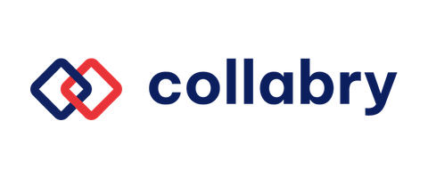
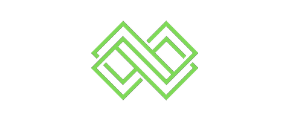
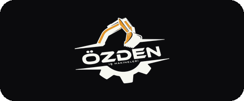
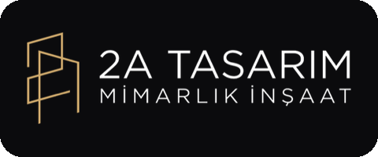
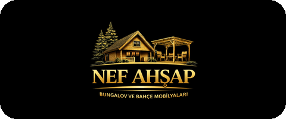
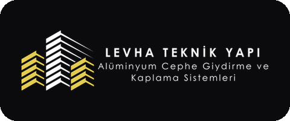

<h1 align="center">Hi, I'm Ahmet Oğuzhan Engin 👋</h1>

  <b>Full-Stack & AI Product Engineer</b> · Istanbul, Türkiye 
  <i>I ship products, not just code.</i>

  
  
  

---

## 🧱 About me

I'm a civil engineer turned software engineer. I graduated **1st in my department** at Işık University on a full scholarship, taught myself software, and kept the builder instinct.

Today I build products **end to end**: product thinking, UI, mobile and web apps, backend, AI integration, store releases and deployment. I'm also doing a thesis-based **M.Sc. in Computer Engineering** on **multi-agent systems**, and I apply that research directly in the agent-based AI features I build.

---

## 💼 Experience

<table>
  <tr>
    <td width="170" align="center"></td>
    <td>
      <b>Fullstack Software Developer</b> · Collabry.io · <i>2023 → present</i> 
      I build consumer and B2B mobile/web products end to end. Three of my apps are live on <b>both the App Store and Google Play</b>:
      <ul>
        <li><b>Şantiye Defteri</b>: construction-site management. Offline-first, PDF/Excel reporting, multi-site, personnel/equipment/expense tracking.</li>
        <li><b>Tutanak Yönetim Sistemi</b>: AI-supported report management. LLM-generated descriptions, photo and location data, company admin, approval workflows.</li>
        <li><b>What Is Your Mood 2</b>: a real-time multiplayer party game. Concurrent sessions over WebSockets, live voting and scoring.</li>
      </ul>
      React Native · Expo · Node.js · PostgreSQL · OpenAI API · WebSockets
    </td>
  </tr>
  <tr>
    <td align="center"></td>
    <td>
      <b>Co-Founder</b> · Stadelon (Clothing & Design) · <i>2023 → 2025</i> 
      Took a brand from idea to a running company, and built its <b>entire e-commerce platform</b> myself: storefront and admin panel, catalog, cart and checkout, <b>iyzico + Stripe</b> payments, coupons, shipping, and order and customer management. 
      Next.js · TypeScript · Supabase · Stripe · iyzico
    </td>
  </tr>
  <tr>
    <td align="center"> <b>Enginity</b></td>
    <td>
      <b>Founder & Operator</b> · <a href="https://enginity.org">Enginity</a> · <i>side business</i> 
      My own digital agency: AI-powered automation, web design and digital marketing for businesses. I handle everything from client brief and design to build, deployment and maintenance. Client work includes the sites below, plus <b>İşmakser</b>, a warehouse and operations system for a two-branch heavy-machinery service company (inventory, stock movements, timesheets, repair work orders). 
      Next.js · Tailwind · Framer Motion · Supabase · Cloudflare · WordPress
    </td>
  </tr>
  <tr>
    <td align="center">🔬</td>
    <td>
      <b>Frontend Developer</b> · LookUs Scientific · <i>2023</i> 
      React frontend work for a scientific/medical technology company.
    </td>
  </tr>
</table>

### 🤝 Clients I've built websites for

  &nbsp;
  &nbsp;
  &nbsp;
  

---

## 🧠 What I know & do

**📱 Mobile (React Native / Expo)**
- Shipping apps to production on **both iOS and Android**, from build to store listing and release
- Offline-first data, PDF/Excel report generation, camera, photo and location features
- Real-time multiplayer over WebSockets

**🌐 Web (React / Next.js)**
- Full-stack Next.js apps: storefronts, admin panels, dashboards, operations systems
- E-commerce end to end: catalog, cart, checkout, **payment integration (iyzico, Stripe)**, coupons, shipping
- Fast, responsive marketing and corporate sites, multilingual including Arabic, deployed on Cloudflare

**🤖 AI / LLM**
- Putting LLMs into **shipped products**, not demos: OpenAI, Google Gemini (text + vision), Claude API
- **Agent-based systems**: multi-agent architectures, orchestrator agents, human-in-the-loop
- **MCP servers**: e.g. *Mevzuat Asistanı*, an agent that live-searches Turkish legislation and cites the exact article, available as a web app, a CLI and an MCP server
- Grounded answers over guessing: tools and live retrieval instead of answering from model memory

**🗄️ Backend & infrastructure**
- Node.js and Python services, REST API design
- PostgreSQL / SQL, Supabase (auth, database)
- Docker, Linux server administration, Cloudflare, CI with GitHub Actions

**🧭 Product & ownership**
- Turning a real-world problem into a product. Şantiye Defteri came from understanding construction-site paperwork first-hand.
- Founder experience: scoping, users and the business side, not just tickets

### Currently building
- ⚖️ **Hukuk Takip**: an all-in-one practice platform for Turkish lawyers, with case delegation (tevkil), a private peer forum, precedent research, a shared agenda and a daily Official Gazette scan by practice area. *Next.js · Supabase · Python · Claude API*
- 📈 **Finans Ajan Sistemi**: a multi-agent market monitor for BIST/US stocks and crypto with isolated per-asset agents and anomaly alerts. This is the applied side of my thesis research. *Python · Flask*

---

## 🧰 Tech stack

---

## 🎓 Education

- **M.Sc. Computer Engineering** (thesis-based), Işık University · *2025 → present* · 100% scholarship · research: **multi-agent systems**
- **B.Sc. Civil Engineering**, Işık University · *2017 → 2021* · 100% scholarship · GPA 3.56/4.00 · **ranked 1st in department**

---

  <b>Building something?</b> I'm open to product engineering roles, technical co-founder conversations, and interesting AI/full-stack problems. 
  📫 <a href="mailto:ahmetoguzhanengin@gmail.com">ahmetoguzhanengin@gmail.com</a>

